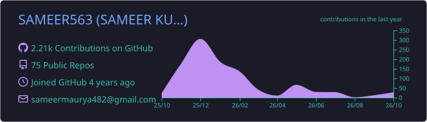
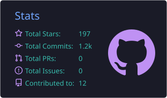
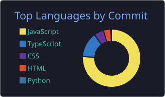
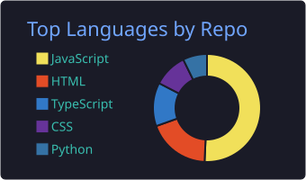
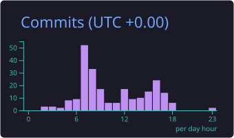

<!-- ===================== HEADER ===================== -->
<p align="center">
  
</p>

<p align="center">
  
</p>

<p align="center">
  
  <a href="https://github.com/SAMEER563?tab=followers"></a>
  
</p>

---

<!-- ===================== ABOUT ===================== -->
### 🧑‍💻 About Me


```js
const sameer = {
  role:       "Oracle APEX Developer",
  enterprise: ["APEX", "PL/SQL", "Fusion AI"],
  fullStack:  ["React", "Next.js", "Node.js", "MongoDB"],
  languages:  ["JavaScript", "TypeScript", "Python"],
  focus:      "Enterprise apps & AI workflows",
};
```

<br clear="right" />

- 💼 Currently working as an **Oracle APEX Developer**
- 🏢 Building enterprise apps with **APEX, PL/SQL & Oracle Fusion AI**
- ⚡ Comfortable from **UI to database** — React on the front, PL/SQL at the core
- 🤝 **Open to collaborating** on exciting projects

---

<!-- ===================== TECH STACK ===================== -->
### 🛠️ Tech Stack

<p align="center">
  
  
  
  
  
</p>

<p align="center">
  
</p>

---

<!-- ===================== STATS ===================== -->
### 📊 GitHub Analytics

<p align="center">
  
</p>

<p align="center">
  
  
</p>

<p align="center">
  
  
</p>

<p align="center">
  <picture>
    <source media="(prefers-color-scheme: dark)" srcset="https://streak-stats.demolab.com?user=sameer563&theme=tokyonight&hide_border=true" />
    
  </picture>
</p>

---

<!-- ===================== CONNECT ===================== -->
### 🌐 Let's Connect

<p align="center">
  <a href="https://linkedin.com/in/sameer-kumar-maurya-5a6990228"></a>
  <a href="https://medium.com/@shakyasam563"></a>
  <a href="http://discordapp.com/users/1079358050256826438"></a>
  <a href="mailto:sameermaurya482@gmail.com"></a>
</p>

<!-- ===================== SNAKE ===================== -->
<p align="center">
  
</p>

<!-- ===================== FOOTER ===================== -->
<p align="center">
  
</p>
